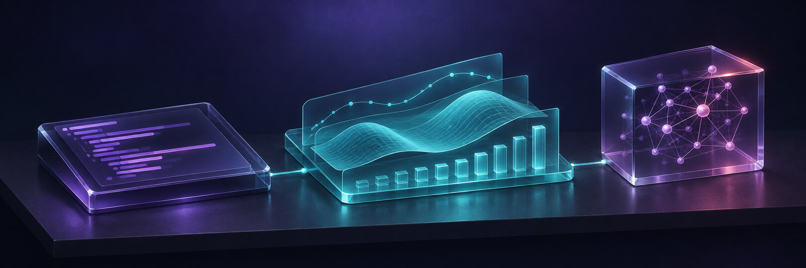

<!-- Apresentação pública do perfil -->

  
  <h1>Programação, dados e inteligência artificial</h1>
  
<strong>Idealização de produtos digitais e automação de processos.</strong>

  
  
  

## 👋 Sobre mim

Minha experiência com operações me ensinou a observar onde o trabalho trava e como a informação circula. Estudo **Ciência de Dados** e uso esse olhar para criar ferramentas que organizam a rotina, apoiam decisões e liberam tempo para quem as usa.

## 🧩 O que desenvolvo

<table>
  <tr>
    <td width="50%" valign="top">
      <strong>🖥️ Produtos digitais</strong> 
      Desenho fluxos e desenvolvo interfaces web e Android para processos de trabalho do dia a dia.
    </td>
    <td width="50%" valign="top">
      <strong>⚙️ Automação e integrações</strong> 
      Conecto sistemas por APIs, transformo regras de negócio em código e automatizo tarefas repetitivas.
    </td>
  </tr>
  <tr>
    <td width="50%" valign="top">
      <strong>📊 Análise de dados</strong> 
      Organizo bases, construo indicadores e desenvolvo painéis para acompanhar a operação.
    </td>
    <td width="50%" valign="top">
      <strong>✦ IA aplicada</strong> 
      Exploro como interpretar pedidos em texto livre, classificar intenções e encaminhar cada caso ao fluxo adequado.
    </td>
  </tr>
</table>

## 🛠️ Tecnologias que uso e estudo

**Dados e visualização**  

**Desenvolvimento web e Android**  

**Versionamento e publicação**  

## 🧭 Como trabalho

- **Descoberta e UX** · Mapeio a jornada, defino prioridades e prototipo a interface.
- **Validação** · Testo as regras e os casos fora do padrão antes de cada entrega.
- **Evolução** · Versiono mudanças, documento decisões e ajusto a partir do uso na prática.
